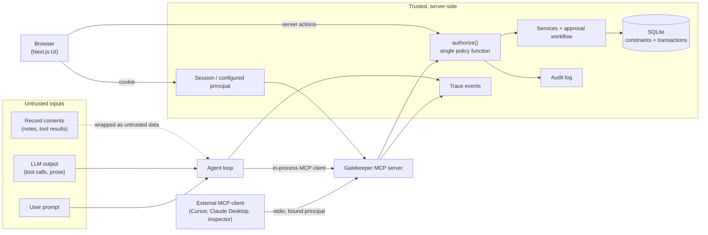
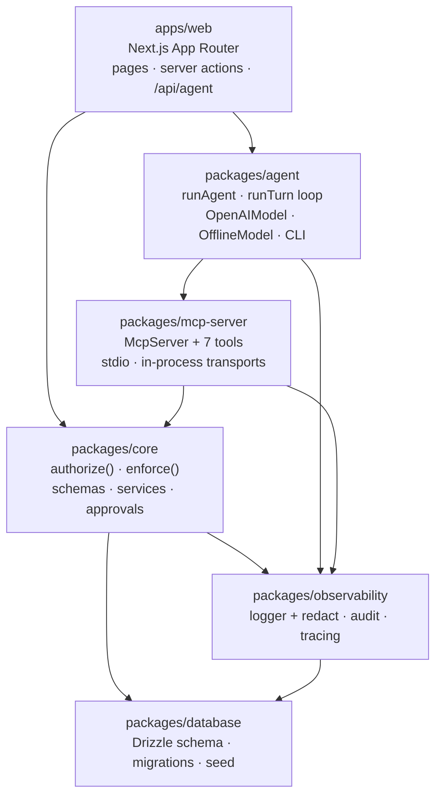
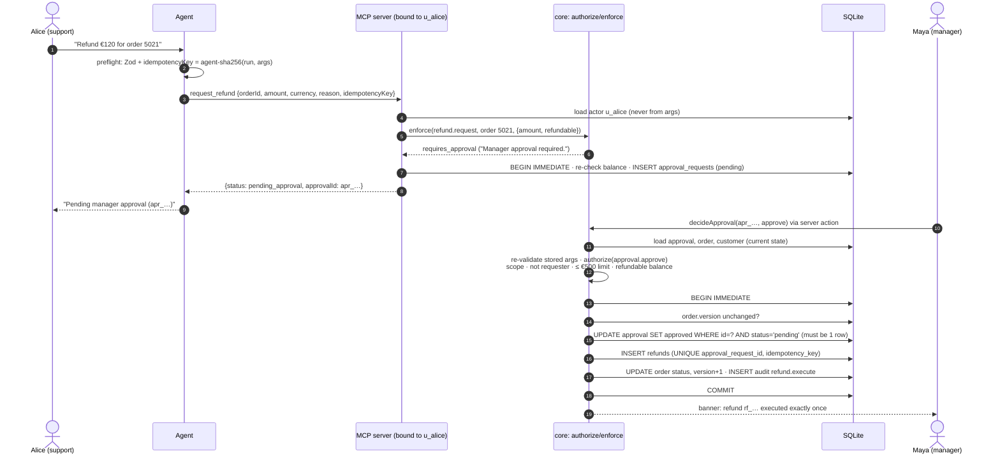

# Gatekeeper architecture

This document follows a **SCOPE** structure:

- **S**ystem context: what Gatekeeper is and where its boundaries are.
- **C**omponents: the packages and what each owns.
- **O**perations: how requests flow end-to-end.
- **P**rotections: where each security property is enforced.
- **E**volution: what would change on the way to production.

> Gatekeeper is a demonstration project. The architecture is designed to be production-*shaped*, but the deployment (SQLite, a dev identity switcher, stdio only) is not production-ready.

---

## S: System context

Gatekeeper lets support staff work with customer data through an AI assistant, without trusting that assistant. There are three kinds of caller and one source of truth:

**Trust boundary:** everything to the left of `authorize()` is either untrusted (prompts, model output, record contents) or only *carries* identity (the session cookie, the stdio configuration). Identity is resolved server-side into an `Actor` loaded from the database. From that point on, nothing the model produces can change who the actor is or what the policy says.

The AI provider (OpenAI) is called only from the server. The API key never reaches the browser, and requests use `store: false`.

## C: Components

| Package | Owns | Does **not** own |
| --- | --- | --- |
| `database` | Tables, unique constraints, migrations, deterministic seed, connection setup (WAL, foreign keys, busy timeout) | Any business rule |
| `observability` | `recordAudit` / `listAuditEvents`, `Tracer` / trace queries, a JSON logger to stderr, `redact()` | Authorization decisions |
| `core` | `authorize()` (pure), `enforce()` (authorize + audit + trace + throw), strict Zod input schemas, services, the approval state machine | Transport, sessions, prompts |
| `mcp-server` | Tool registration, mapping service results/errors to the result envelope, principal binding per server instance | Policy (delegates to `core`) |
| `agent` | Tool discovery, pre-flight validation, idempotency keys, budgets/timeouts, the reply guard, conversation persistence | Identity, policy |
| `web` | Sessions, pages, server actions for approvals/switching/reset, the agent API route | Policy (calls `core` like every other channel) |

The packages export TypeScript source. Next.js transpiles them (`transpilePackages`), `tsx` runs the CLIs and the stdio server, and Vitest imports them directly. There is no separate build step to drift out of date.

### Data model

| Table | Purpose | Key constraints |
| --- | --- | --- |
| `users` | Demo principals: role, team, refund approval limit (cents) | |
| `customers` | Contact details, account status, assigned rep | FK → users |
| `orders` | Amount (cents), status, `version` | `version` is the optimistic-concurrency fence |
| `approval_requests` | Operation, resource, stored validated arguments, requester, status, decision | `UNIQUE(requester_id, idempotency_key)` |
| `refunds` | Executed refunds only | `UNIQUE(approval_request_id)`, `UNIQUE(idempotency_key)` |
| `audit_events` | Security-relevant decisions and changes | Append-only by convention |
| `trace_events` | Diagnostic timeline per request (`correlation_id`) | Separate from audit |
| `sessions` | `SHA-256(token)` → user, expiry | Raw token never stored |
| `agent_messages` | Per-session conversation (`model_item` for the model, `display` for the UI) | |

Money is stored as integer cents everywhere. Timelines are ordered by SQLite `rowid` (insertion order) rather than timestamps, which can collide within a millisecond.

## O: Operations

### An agent request

1. `POST /api/agent` resolves the session from the `gk_session` cookie (401 if absent or expired). The body contains only the message.
2. `runAgent` creates a correlation ID and a `Tracer`, then **creates a fresh MCP server bound to the session's user ID** and connects to it through `InMemoryTransport.createLinkedPair()`. One server per run means the principal is fixed at construction and can never be shared across users.
3. `discoverTools` lists the server's tools and keeps only the allowlisted seven.
4. `runTurn` loops: call the model → for each function call, **pre-flight** it (strict Zod parse of the arguments; for `request_refund`, inject a deterministic idempotency key) → `callTool` over MCP with a per-call timeout → append the result, wrapped as untrusted data, to the conversation. The loop stops on a final message, the tool-call budget (6), the model-call budget (8), or the run timeout (90 s).
5. Each MCP tool handler re-loads the actor from the database, parses input, loads the resource facts, calls `enforce()` (authorize → audit event → trace event → throw on deny), and runs the service.
6. The final reply passes through `verifyReply`, which replaces false claims that a refund succeeded unless an approval status tool confirmed execution. The reply, tool-call records and model items are persisted.

### Refund request → approval → execution

If authorization fails at decision time because of the **resource's** state (the order was cancelled or refunded elsewhere, the account was closed, the balance shrank), the request is moved to `invalidated` instead of being left pending forever. If it fails because of the **approver** (wrong team, over their limit, self-approval), the request stays pending for someone who is allowed to decide it. `RESOURCE_STATE_CODES` in `policy.ts` encodes that split.

### Direct web operations

Pages and server actions use the same `ExecutionContext` and services as the MCP tools, with `channel: "web"`. Page reads are audited. User actions (approve, reject, switch user) are also traced, so they show up in the execution viewer next to agent runs.

### Stdio

`packages/mcp-server/src/transport/stdio.ts` loads `GATEKEEPER_DEMO_PRINCIPAL`, refuses to start if it is missing or unknown, and serves one principal for the process lifetime with `channel: "mcp-stdio"`. Stdout carries only JSON-RPC; logs go to stderr.

## P: Protections

| Property | Mechanism | Location |
| --- | --- | --- |
| Identity never comes from the model | Principal bound at server construction; no identity fields in any schema (`z.strictObject` rejects extras); actor re-loaded per call | `mcp-server/src/server.ts`, `core/src/schemas` |
| Fail closed | `authorize()` denies with `unauthenticated` when the actor is null; stdio refuses to start; `/api/agent` returns 401; pages render a signed-out state | `core/src/authorization/policy.ts` |
| Single policy | `authorize()` is pure and deterministic, the only place rules live, and called by every channel through `enforce()` | `core/src/authorization` |
| Cross-user isolation | Scope check: support = assigned rep, manager = same team, admin = all; list endpoints filter rows through the same check | `policy.ts` `checkScope`, services |
| Writable-field allowlist | `UpdateCustomerInput` permits only `email`, `phone`, `accountStatus`; the policy further restricts by role | `schemas`, `WRITABLE_CUSTOMER_FIELDS` |
| Financial limits | Per-user `refund_approval_limit_cents`, checked at decision time | `policy.ts` |
| Four-eyes | Every refund request → `requires_approval`; requester ≠ approver; the agent has no approval tool | `policy.ts`, `TOOL_DEFINITIONS` |
| Exactly-once | Idempotency keys + `UNIQUE` constraints + conditional update + order version, in an immediate transaction | `approvals.ts`, `schema.ts` |
| No blind retries | Tool calls are attempted once; `request_refund` always carries an idempotency key (agent-derived if absent) | `agent/src/tools.ts` |
| Prompt-injection containment | Tool output wrapped as untrusted data; instructions say so; **nothing depends on the model complying** | `agent/src/prompt.ts` |
| Bounded agent | Tool/model call budgets, per-call and per-run timeouts, explicit stop reasons | `agent/src/orchestration.ts` |
| Honest replies | Fallback replies built from tool records; `verifyReply` blocks unconfirmed refund-success claims | `orchestration.ts` |
| Secret / PII hygiene | `redact()` on log payloads; audit stores changed field *names*, not values; prompts previewed with masking; session tokens hashed | `observability`, services |

Audit events and traces are stored and shown separately on purpose. **Audit** answers *who was allowed or denied what*. Every authorization decision is recorded before the action runs, and the `refund.execute` event is written inside the same transaction as the refund itself. It is the record you'd hand to a security reviewer. **Traces** answer *how did this request execute*: timings, model calls, tool selection. They are best-effort diagnostics.

## E: Evolution

What would change to take this toward production:

1. **Authentication.** Replace the demo switcher with OIDC/SAML single sign-on; rotate sessions on login and privilege change; require step-up MFA for approvals.
2. **Remote MCP.** Add Streamable HTTP with OAuth 2.1 bearer tokens validated against the identity provider (audience-bound, short-lived), resolving the principal **per request**, never from tool arguments or client-supplied metadata. See [security.md](security.md#remote-transports).
3. **Policy as data, still not as prompt.** Move role permissions and limits into an admin-managed, audited configuration (or a policy engine such as Cedar/OPA), keeping the same `authorize()` contract and tests.
4. **Storage.** PostgreSQL with the same unique constraints, `SELECT … FOR UPDATE` or serializable transactions in place of `BEGIN IMMEDIATE`, and an outbox for refund side effects to a payment provider, keyed by the same idempotency key.
5. **Operations.** Rate limiting per user and per tool, OpenTelemetry export for traces, tamper-evident audit storage, data retention policies.
6. **Model governance.** Live evals in CI on a schedule, red-team prompt suites, model and version pinning, and monitoring of the guard's interventions.
